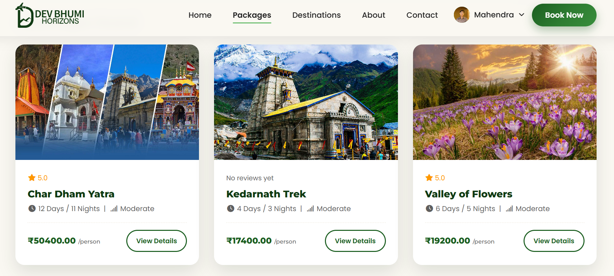
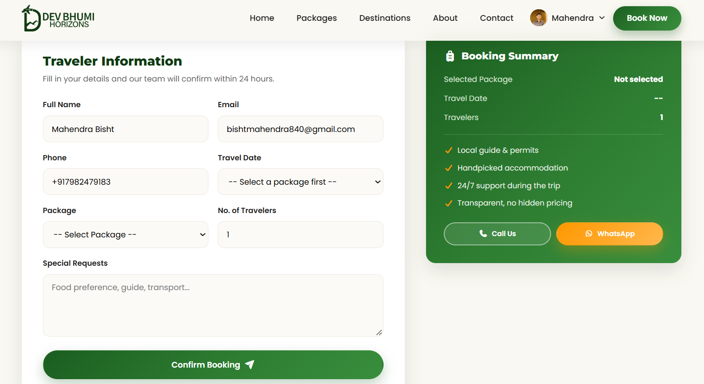
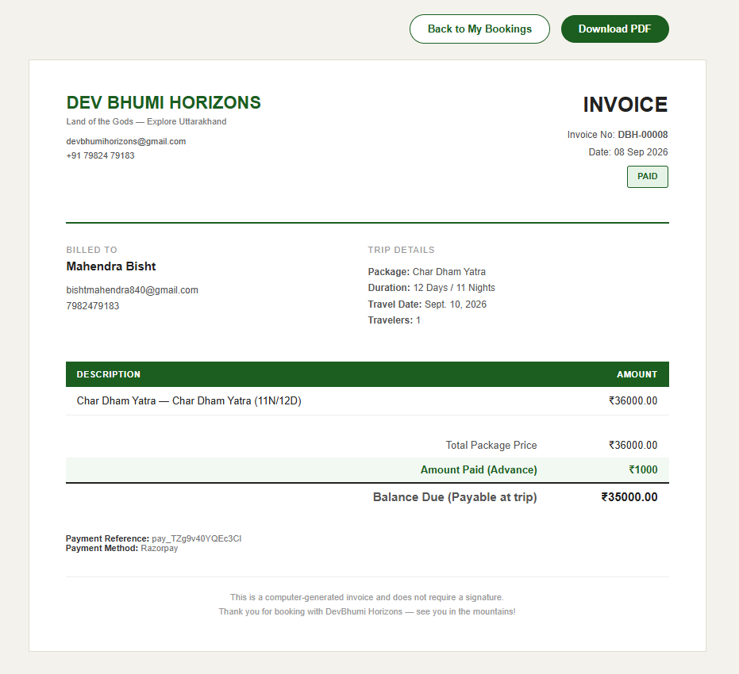

<div align="center">


<br>


-0C2451)


**A full-stack travel booking platform for curated treks, pilgrimages and getaways across Uttarakhand.**

[**Live demo**](https://devbhumi-horizons.onrender.com) &nbsp;·&nbsp; [Features](#-features) &nbsp;·&nbsp; [Tech stack](#-tech-stack) &nbsp;·&nbsp; [Run locally](#-run-locally) &nbsp;·&nbsp; [Deployment](#-deployment)

</div>

> **Portfolio project.** Payments run in **Razorpay test mode**, so no real money is charged and no real bookings are made.
> The demo is hosted on a free Render instance, so the **first load can take about a minute** while it wakes up.

---

## ✨ Features

**For travelers**
- Browse and search trek and pilgrimage packages, with detail pages that show the day-wise itinerary, food and stay, travel and driver options, a transparent price breakdown and a photo gallery
- Sign up with an **email OTP**, or continue with **Google**; password reset by email
- Book a package, pay an **advance online with Razorpay**, and pay the balance at the trip
- Download a **PDF invoice**; a copy is also emailed after payment
- **Cancel a booking** and get the refund back through Razorpay
- Review a booked package (reviews appear after moderation) and manage your own profile and picture

**Under the hood**
- Seat limits per package, checked at booking time
- Payment signature verification on the server before a booking is marked paid
- Row locking on cancellation, so a double click cannot refund the same booking twice
- Rate limiting on OTP, login and review endpoints
- `sitemap.xml` and `robots.txt` for search engines
- Optional Sentry error tracking, logging to stdout, and HTTPS, HSTS and secure cookies in production

## 🧰 Tech stack

| Layer | Tools |
|---|---|
| Backend | Python 3.13, Django 6.0, Gunicorn |
| Database | PostgreSQL ([Neon](https://neon.tech)) in production; SQLite or MySQL locally |
| Frontend | Django templates, vanilla JavaScript and CSS, Font Awesome |
| Payments | Razorpay (test mode) |
| Email | Brevo over its HTTPS API via `django-anymail` (works on hosts that block SMTP) |
| Auth | Custom email-based user model, email OTP, Google sign-in |
| Media and static | Cloudinary for uploads, WhiteNoise for static files |
| PDF | WeasyPrint |
| Security and ops | `django-ratelimit`, Sentry (optional) |
| Hosting | Render (web service), Neon (database) |

## 🗂 Project structure

```text
.
├── manage.py
├── requirements.txt            # production dependencies
├── .env.example                # environment variable template (no secrets)
├── traveling_project/          # project settings, root URLs, WSGI
└── travelingapp/               # the main app
    ├── models.py               # Package, Booking, Review, Profile, custom User ...
    ├── views.py                # pages, auth, payments, invoices, reviews
    ├── urls.py
    ├── seo.py                  # sitemap.xml and robots.txt
    ├── client_ip.py            # safe client-IP lookup for rate limiting
    ├── templates/travelingapp/
    ├── static/travelingapp/    # css, js, images
    └── migrations/
```


## 📸 Screenshots

| Home | Package details |
|---|---|
|  |  |

| Booking and payment | Invoice |
|---|---|
|  |  |


## 🚀 Run locally

**Requirements:** Python 3.13 and Git. WeasyPrint also needs the Pango library for PDF invoices
(Linux: `sudo apt install libpango-1.0-0 libpangoft2-1.0-0`; macOS: `brew install pango`; Windows: install the GTK runtime).

```bash
# 1. Clone and enter the project
git clone https://github.com/Mahendra-Singh07/DevBhumi-Horizons.git
cd DevBhumi-Horizons

# 2. Create a virtual environment and install dependencies
python -m venv venv
source venv/bin/activate          # Windows: venv\Scripts\activate
pip install -r requirements.txt

# 3. Create your .env from the template, then edit the values
cp .env.example .env              # Windows: copy .env.example .env

# 4. Set up the database and run the server
python manage.py migrate
python manage.py createsuperuser
python manage.py runserver
```

Open <http://127.0.0.1:8000/> (it redirects to `/travel/`). Add packages from the admin at `/admin/`.

The `.env.example` defaults use SQLite and print emails (including OTP codes) to the terminal, so you do not need MySQL or an email account to try the app.

## 🔐 Environment variables

Copy `.env.example` to `.env`. **Never commit `.env`.**

| Variable | Needed | Purpose |
|---|---|---|
| `SECRET_KEY` | Yes | Django secret key |
| `DEBUG` | No | `True` for local development; defaults to `False` |
| `ALLOWED_HOSTS` | Production | Comma-separated host names |
| `DATABASE_URL` | Yes | e.g. `sqlite:///db.sqlite3` or a Postgres URL |
| `EMAIL_HOST_USER` | Yes | Sender address (must be a verified sender in production) |
| `EMAIL_PROVIDER` | No | `console` (print emails), `smtp` or `brevo` |
| `BREVO_API_KEY` | If `brevo` | Transactional email API key |
| `GOOGLE_CLIENT_ID` | Yes | Google sign-in client ID |
| `RAZORPAY_KEY_ID`, `RAZORPAY_KEY_SECRET` | Yes | Razorpay **test** keys |
| `USE_CLOUDINARY` | No | Store uploads on Cloudinary (on by default when `DEBUG=False`) |
| `CLOUDINARY_CLOUD_NAME`, `CLOUDINARY_API_KEY`, `CLOUDINARY_API_SECRET` | If Cloudinary | Media storage |
| `SENTRY_DSN` | No | Enables error tracking |
| `LOG_LEVEL` | No | `INFO` by default |
| `TRUSTED_PROXY_COUNT` | No | Number of reverse proxies in front of the app, used for rate-limit IPs |

## ☁️ Deployment

The live site runs on **Render** (free web service) with a **Neon** Postgres database.

| Setting | Value |
|---|---|
| Python version | `3.13` (from `.python-version`) |
| Build command | `pip install -r requirements.txt && python manage.py collectstatic --noinput && python manage.py migrate --noinput` |
| Start command | `gunicorn traveling_project.wsgi:application --workers 1 --threads 4 --timeout 60` |

Set the environment variables from the table above in the Render dashboard. Auto-deploy runs on every push to the connected branch.

## 🧪 Payments in the demo

The demo uses Razorpay **test mode**. To try a payment, use the test card details from the
[official Razorpay documentation](https://razorpay.com/docs/payments/payments/test-card-details/). No real card is needed and nothing is charged.

## 🛣 Roadmap

- [ ] Custom domain
- [ ] Automated tests for booking and payment flows
- [ ] Per-package SEO metadata and structured data
- [ ] Razorpay live mode after business verification

## 👤 Author

**Mahendra Singh**
[GitHub](https://github.com/Mahendra-Singh07) · [LinkedIn](https://www.linkedin.com/in/mahendra-singh-developer/)

<sub>Built as a learning and portfolio project. Feedback and suggestions are welcome through GitHub issues.</sub>